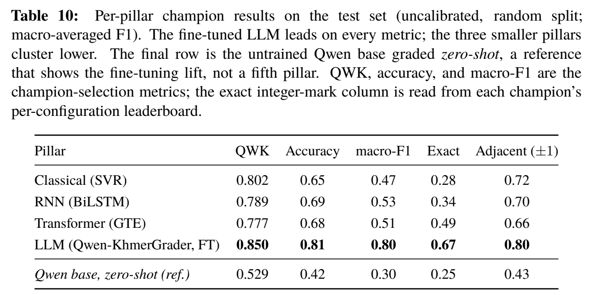
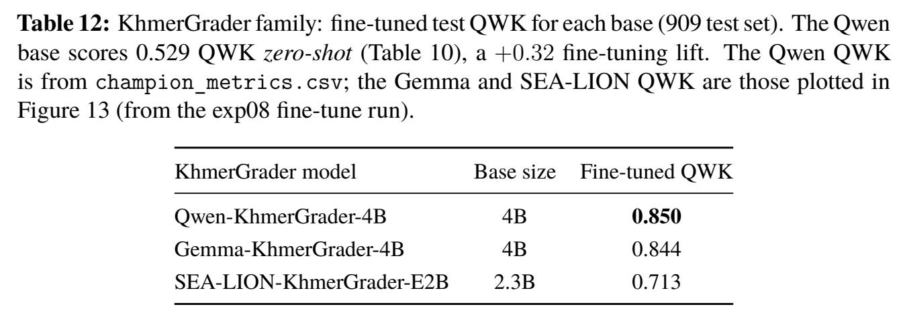
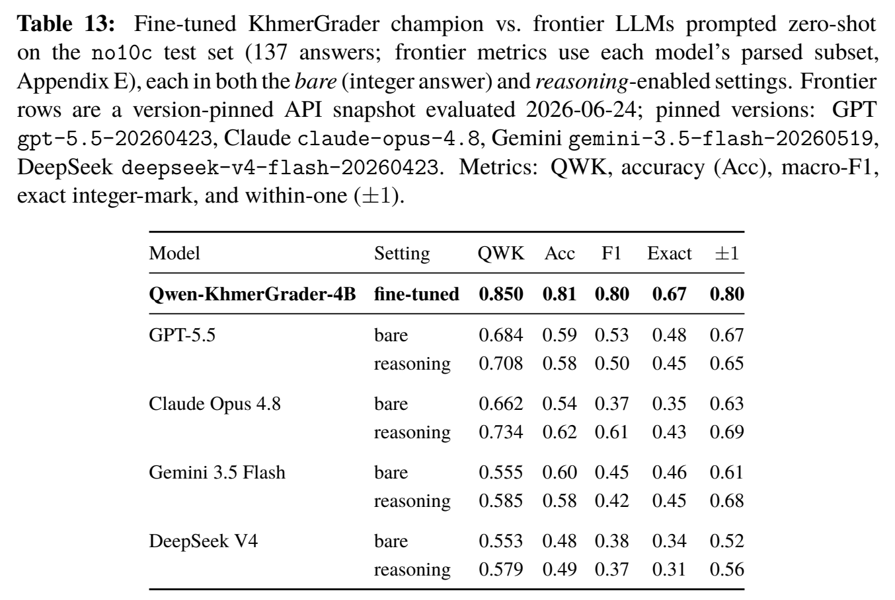
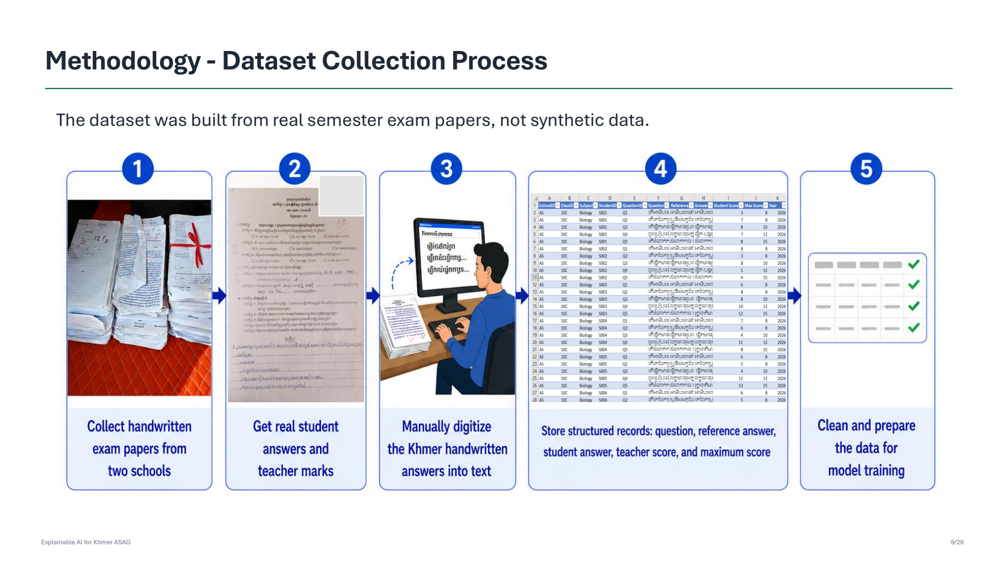

# Explainable AI for Automated Grading of Khmer Language Short-Answer Questions in Education


**Phork Norak** · Supervisor: **Dr. Khim Chamroeun**

Royal University of Phnom Penh · Bachelor of Engineering in Data Science and Engineering

**[Final report](<docs/reports/Explainable AI for Automated Grading of Khmer Language Short-Answer Questions in Education.pdf>)** · **[Presentation](docs/reports/Final_Presentation.pdf)** · **[Hugging Face](https://huggingface.co/datasets/phorknorak/khmer-asag-benchmark)** · **[Kaggle](https://www.kaggle.com/datasets/phorknorak/khmer-asag-benchmark)** · **[ResearchGate](https://www.researchgate.net/publication/416039997_Explainable_AI_for_Automated_Grading_of_Khmer_Language_Short-Answer_Questions_in_Education)** · **[Release](https://github.com/PhorkNorak/Explainable-AI-for-Automated-Grading-of-Khmer-Language-Short-Answer-Questions-in-Education/releases/tag/v1.1.0)**

> **Undergraduate research · June 2026.** Real Khmer examination answers, four grading model families, and SHAP word attribution in one research pipeline and prototype.

[Abstract](#abstract) · [Key results](#key-results) · [Research questions](#research-questions) · [Dataset](#dataset) · [Explainability](#explainability) · [Quick start](#quick-start) · [Prototype](#prototype) · [Documentation](#documentation) · [Reproducibility](#reproducibility) · [Citation](#citation)

## Abstract

Grading short answers takes time, and Khmer has few resources for automated educational assessment. This project studies automated short-answer grading using **1,184 real, teacher-graded answers** manually digitised from handwritten examinations at two Cambodian high schools. It compares classical machine learning, a recurrent neural network, multilingual Transformer encoders and the fine-tuned **KhmerGrader** language-model family. Qwen-KhmerGrader-4B achieves the highest reported Quadratic Weighted Kappa (QWK), **0.850**. The encoder uses a different test set, so cross-family results are indicative. SHAP word attribution highlights words contributing to each prediction, and a Gradio prototype combines scores, optional highlighting and written feedback. The results measure agreement with one teacher and support research on grading assistance; classroom benefit has not been established.

This repository provides the experiment code, final report and presentation, dataset documentation and prototype. Public dataset copies are hosted separately on Hugging Face and Kaggle.

## Key results

- **Highest reported QWK:** Qwen-KhmerGrader-4B, **0.850**, compared with Classical **0.802**, BiLSTM **0.789** and GTE **0.777**.
- **Raw-mark agreement:** the Qwen champion matches the teacher's exact mark on **67%** of test answers and is within one point on **80%**.

The benchmark images below are reproduced directly from the final report, preserving its captions, values and formatting.

### Four model families



Classical, BiLSTM and LLM headline rows use the **137-answer no10c test set**; the encoder uses the **178-answer full test set**. This is not a strict comparison on a common test set.

<details>
<summary><strong>KhmerGrader family comparison: original report Table 12</strong></summary>



The family adapts Qwen, Gemma and SEA-LION bases using QLoRA. The caption says “909 test set”; 909 is the corpus-variant size, while the headline Qwen held-out test has 137 answers. See the [model cards and lineage](docs/guides/model_cards.md).

</details>

<details>
<summary><strong>Frontier comparison: original report Table 13</strong></summary>



The report compares the fine-tuned champion with GPT-5.5, Claude Opus 4.8, Gemini 3.5 Flash and DeepSeek V4 in bare and reasoning-enabled zero-shot settings. The highest reported frontier QWK is **0.734**, for Claude Opus 4.8 with reasoning. Metrics use each model's parsed subset, so sample counts differ. These are saved, report-stated benchmark results, not a new external evaluation.

</details>

These are historical, report-stated benchmarks. See [reproducibility](#reproducibility) before comparing them with a new run or a later dataset version.

## Research questions

1. **RQ1:** Which model family gives the best agreement with the human teacher?
2. **RQ2:** Which model is most useful for classroom deployment based on exact mark and within-one-point agreement?
3. **RQ3:** Can SHAP provide understandable word-level explanations across all model families?

### Approach

| Family | Models and method |
|---|---|
| Classical | Character TF-IDF features with RBF-SVR |
| RNN | Character BiLSTM with additive attention; SHAP supplies explanations |
| Transformer | Multilingual mBERT, XLM-R and GTE encoders |
| LLM | **KhmerGrader**, using QLoRA fine-tuning of Qwen, Gemma and SEA-LION bases |

For regression models, the target is `Student Score / Max Score`. Predictions map to five grades with `round(4 * predicted_score)` and to raw points with `round(predicted_score * max_score)`, bounded to valid ranges. SVR uses its regression objective and neural regression heads use MSE. Generative LLM fine-tuning instead supervises integer-score completions.

Preprocessing strips invisible characters, applies NFC and removes punctuation; `segment` also applies khmernltk word segmentation. There is no custom KCC reorder. The [experiment registry](experiments/README.md) explains the implemented stages and commands. Documentation describes the final-report models; subsequent experiments are outside its scope.

## Dataset

**Real student work, manually digitised.** Answers come from handwritten semester 1 examinations in the 2026 school year, collected at two Cambodian high schools, one in a province and one in the capital city. Scores were assigned by one teacher. No generated or crowd-sourced answers are included.

| | Full corpus | Curated corpus |
|---|---:|---:|
| Answers | **1,184** | **909** |
| Questions | 41 | 36 |
| Students | 203 | 203 |
| Schools | 2 | 2 |
| CSV | `dataset.csv` | `dataset_no_10c_biology.csv` |
| Hugging Face configuration | `full` | `curated-no10c` |

Subjects are **Biology, History, Geography and Earth Science**. The curated `no10c` corpus excludes class-10C Biology, where inconsistent grading was identified. Both retain grade 0, and the curated corpus is a subset of the full corpus.

**Reference answers.** An official teacher-provided answer key was unavailable. The highest-scoring student response for each question serves as the reference. This is a student-derived proxy, which can be incomplete, rather than a verified marking rubric.

The [dataset card](docs/guides/dataset.md) documents the schema, downloads, version history and citation.

**Latest dataset update, 17 October 2026:** dataset **v1.0.1** corrects one answer's mark from **19/15 to 9/15** in both CSVs. Counts and other public cells are unchanged. On Kaggle, this is **version 2**. Dataset versions and software release versions are separate.

<details>
<summary><strong>Collection workflow, schema and quality notes</strong></summary>

The collection process preserved student answers and teacher marks, manually transcribed Khmer handwriting, organised records and prepared the shared modelling input. The original workflow slide is reproduced below.



CSV columns are `SchoolID`, `ClassID`, `Subject`, `StudentID`, `QuestionID`, `Question`, `Reference`, `Answer`, `Student Score`, `Max Score` and `Year`. The public exports use replacement school codes and pseudonymous class/student codes. One blank-answer source record is excluded from each public file.

Question maxima are 5, 6, 7, 8, 10, 12, 15 and 20 points. Real grading noise includes identical answers receiving different marks, question repetition and zero-score responses with no meaningful content. Subjects and scores are unevenly represented, with few Earth Science answers.

The report uses a label-stratified, answer-level **70/15/15 split with seed 42**. On Hugging Face, the hosted split named `train` contains the entire selected configuration; the project code makes the research partitions.

For collection details, see report Section 3.2 and presentation PDF pages 8-12. [Ethics and data access](docs/guides/ethics.md) explain the single-grader, privacy and governance limits. Public availability does not independently establish consent or ethics approval.

</details>

## Explainability

SHAP highlights answer words that contribute to the predicted score. Plausibility measures the fraction of the top 20% SHAP words that appear in the reference answer. It is a lexical-overlap proxy, not a teacher evaluation of explanation quality.

Report Table 14 gives plausibility **0.63 / 0.60 / 0.68 / 0.61** for Classical / BiLSTM / Encoder / LLM on **66 / 66 / 18 / 18** answers. The saved summary matches after rounding; unequal samples limit ranking. Table 11 reports approximate **score-plus-SHAP** latency of **2 / 13 / 10 / 76 seconds** per answer, respectively. These are capped-explanation costs, not score-only timings. See the [SHAP](docs/guides/report_evidence.md#shap-plausibility) and [efficiency](docs/guides/report_evidence.md#efficiency) evidence notes.

## Quick start

The steps below set up the CPU prototype in an isolated environment using **Python 3.10 or later**. For the full experiment dependencies and GPU work, see [reproducibility](#reproducibility).

### 1. Clone and install

```bash
git clone https://github.com/PhorkNorak/Explainable-AI-for-Automated-Grading-of-Khmer-Language-Short-Answer-Questions-in-Education.git
cd Explainable-AI-for-Automated-Grading-of-Khmer-Language-Short-Answer-Questions-in-Education

python -m venv .venv
source .venv/bin/activate
python -m pip install --upgrade pip
python -m pip install -r prototype/requirements.txt
python -m pip install -e .
```

<details>
<summary><strong>Windows PowerShell activation</strong></summary>

After creating `.venv`, replace the activation command above with:

```powershell
.venv\Scripts\Activate.ps1
```

Then continue with the three `python -m pip` commands above.

</details>

### 2. Download the dataset

Download both CSVs from [Hugging Face](https://huggingface.co/datasets/phorknorak/khmer-asag-benchmark) or [Kaggle](https://www.kaggle.com/datasets/phorknorak/khmer-asag-benchmark/versions/2) and place them here:

```text
local/data/dataset.csv
local/data/dataset_no_10c_biology.csv
```

Preserve existing research copies and hashes before replacing them. Local CSVs stay ignored by Git. The [dataset guide](docs/guides/dataset.md#download-and-use) includes loading examples.

### 3. Launch the prototype

```bash
python prototype/app.py
```

Open **http://127.0.0.1:7860**. See [prototype setup and model configuration](prototype/README.md) for optional backends and environment settings.

## Prototype

The **KhmerXScore** Gradio prototype accepts a question, reference answer and student answer, then shows a predicted score, optional SHAP word highlighting and written feedback. The Classical demo refits from local data at startup; other families need compatible checkpoints or configured endpoints. A source checkout alone does not provide a fully populated demo.

Written feedback uses an **open-source instruct LLM** through `FEEDBACK_LLM_*`, with a rule-based fallback when no server is reachable. Teacher review remains part of the intended workflow. No public live-demo URL or completed classroom field study is verified.

## Documentation

| Resource | Contents |
|---|---|
| [Final report and presentation](docs/reports/README.md) | Approved 67-page report, supplied slide PDF and version history |
| [Dataset card](docs/guides/dataset.md) | Provenance, schema, correction record, downloads and licence |
| [Model cards](docs/guides/model_cards.md) | KhmerGrader names, base-model lineage and configuration |
| [Report-to-evidence notes](docs/guides/report_evidence.md) | Saved summaries, test-set differences and historical audit findings |
| [Ethics and data access](docs/guides/ethics.md) | Privacy, single-grader limitations and intended use |
| [HPC workflow](docs/guides/hpc.md) | Isolated runs, data checks and evidence preservation |
| [Slides](docs/guides/slide_final.md), [speaker notes](docs/guides/script.md) and [defense questions](docs/guides/defense_qa.md) | Supporting presentation materials |
| [Repository guide](docs/guides/repository_guide.md) | Public files, local artifacts and Git inclusion policy |

### Repository structure

```text
src/khmer_asag/   Data loading, preprocessing, training, models and SHAP
experiments/     Experiment definitions and shared helpers
prototype/       Gradio application and setup guide
scripts/         Pipeline runners, analysis and HPC handoff
tests/           Scoring, SHAP, prototype, path and handoff checks
docs/            Guides, report tables, final report and presentation
local/           Ignored data copies, results, checkpoints and manuscripts
```

Imports use `khmer_asag`; central artifact paths are defined in `src/khmer_asag/paths.py`. Saved results live under `local/results/`, champion checkpoints under `local/checkpoints/results/champions/`, and logs, builds, manuscript sources and historical archives under `local/`. Original data, predictions, model weights and all LaTeX/bibliography sources remain excluded from Git. Final report and presentation PDFs are public.

## Reproducibility

The final PDF and champion summary agree on the displayed headline values, but the historical audit did not recover one coherent matching set of predictions and checkpoints. Report metrics have **not been rerun on dataset v1.0.1**. Its score correction can change the derived label and label-stratified split membership, even with seed 42. No new training or benchmark API evaluation was performed for this documentation and dataset update.

For research experiments, use a separate environment from the prototype. For GPU work, first install the PyTorch build appropriate to the driver and CUDA environment reported by `nvidia-smi`. Then install the full dependencies:

```bash
python -m pip install -r requirements.txt
python -m pip install -e .
```

Classical and individual BiLSTM work are CPU-feasible; encoder and LLM training belong on HPC. See the [experiment registry](experiments/README.md) for script arguments and the [HPC workflow](docs/guides/hpc.md) for isolated runs. Use fresh output directories and record dataset hashes, split membership and model revisions, preserving historical evidence.

Scores measure agreement with one grader, not independently established correctness, fairness or classroom benefit. The [report-to-evidence notes](docs/guides/report_evidence.md) retain the unresolved checkpoint, prediction, preprocessing and SHAP provenance findings.

## Citation

Please cite the report and the dataset version you use. Machine-readable software metadata is available in [CITATION.cff](CITATION.cff).

```bibtex
@techreport{phork2026khmergrading,
  author      = {Phork, Norak},
  title       = {Explainable AI for Automated Grading of Khmer Language Short-Answer Questions in Education},
  institution = {Royal University of Phnom Penh},
  year        = {2026},
  month       = jun,
  url         = {https://www.researchgate.net/publication/416039997_Explainable_AI_for_Automated_Grading_of_Khmer_Language_Short-Answer_Questions_in_Education}
}

@dataset{phork2026khmerasag,
  author  = {Phork, Norak},
  title   = {Khmer Automatic Short-Answer Grading Benchmark},
  year    = {2026},
  version = {1.0.1},
  url     = {https://huggingface.co/datasets/phorknorak/khmer-asag-benchmark}
}
```

## Contributing

Corrections, reproducibility findings and improvements to Khmer text handling are welcome. Read the [contribution guide](CONTRIBUTING.md) before opening an issue or pull request. For dataset corrections, include the host, version, CSV and row reference without sharing private source records or identifying information.

## Licence

**Code:** [MIT](LICENSE). **Dataset:** [CC BY-NC 4.0](https://creativecommons.org/licenses/by-nc/4.0/), requiring attribution and excluding commercial use. Third-party models and papers retain their own licences and access terms.
